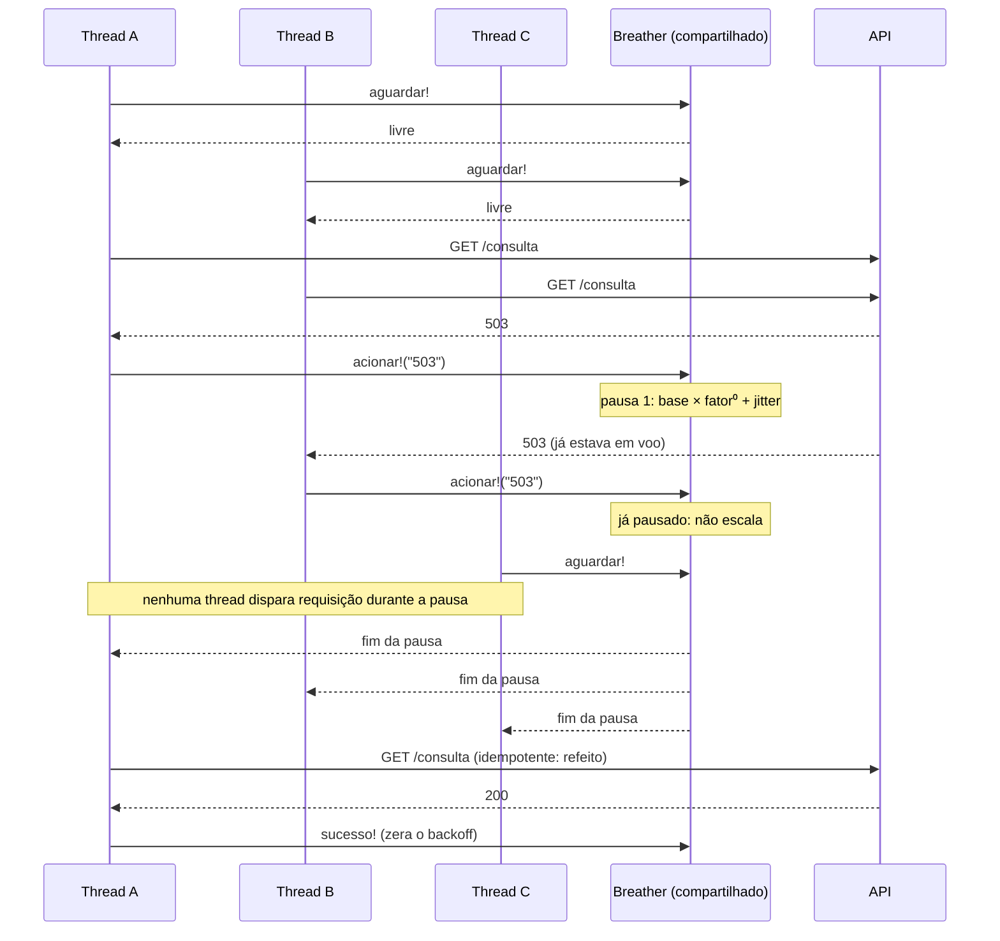

<p align="center"></p>

<p align="center">
  <a href="https://github.com/Dimasaas/freio/actions/workflows/ci.yml"></a>
  
  
  
</p>

# Breather

> freio global cooperativo para APIs que devolvem 503

O Breather é um freio **global e cooperativo** para APIs que devolvem `503` em janelas. No primeiro 503, **todas** as threads que compartilham o mesmo freio pausam, com backoff exponencial, teto e jitter. Só a operação marcada como **idempotente** é refeita: escrita nunca é repetida. Ruby puro, sem dependências de runtime. Relógio e `sleep` são injetáveis, então os testes não esperam de verdade.

## Por que existe

Um ERP corporativo atrás de IIS devolvia 503 em janelas de 25 a 30 segundos, e o 503 vinha do listener do sistema operacional, antes de a requisição chegar à aplicação. Não havia o que "contornar": só esperar a janela passar.

O cliente tinha retentativa **por thread**: cada worker gastava suas 3 tentativas em poucos segundos e seguia para a consulta seguinte. Medido em uma rodada de lote: **~84 requisições por janela contra um servidor fora do ar**, com 4 workers e 7 rodadas, e dezenas de consultas empurradas para uma segunda passada. Pior: uma sonda de saúde, em outro processo, com uma única chamada, também levou 503. A janela era do servidor inteiro, e a nossa carga só piorava o estrago.

O Breather troca "cada thread se vira" por "uma decisão para todas": quem leva o primeiro 503 abre a pausa, quem vem depois espera, e cada janela recebe só o que já estava em voo mais uma sonda.



## Uso

```ruby
require "breather"

# Um freio por "servidor" a proteger, compartilhado entre as threads.
BREATHER = Breather.new(base: 5, teto: 60, fator: 2, jitter: 0.2)

# Leitura: idempotente, pode ser refeita depois da pausa.
dados = Breather.executar(BREATHER, idempotente: true) do
  resposta = http.get("/consulta")
  raise Breather::Indisponivel.new("503", retry_after: resposta.retry_after) if resposta.status == 503
  resposta.body
end

# Escrita: aciona o freio para as outras threads, mas NUNCA é repetida.
Breather.executar(BREATHER, idempotente: false) do
  resposta = http.post("/pedidos", corpo)
  raise Breather::Indisponivel if resposta.status == 503
  resposta
end
```

| Método | O que faz |
|---|---|
| `Breather.new(base:, teto:, fator:, jitter:, relogio:, dormir:, sorteio:, fatia:, ao_acionar:)` | Cria o Breather. Valida os parâmetros. |
| `#aguardar!` | Bloqueia enquanto houver pausa. Devolve `true` se esperou. Chamar antes de **cada** requisição. |
| `#acionar!(motivo, espera: nil)` | Abre a pausa global. Devolve a duração, ou `nil` se já havia pausa em curso. `espera` é um piso (ex.: `Retry-After`). |
| `#sucesso!` | Zera o backoff (sem mexer numa pausa em curso). |
| `#liberar!` | Encerra a pausa agora e zera o backoff. |
| `#pausado?`, `#restante`, `#pausas`, `#seguidas` | Observação. |
| `Breather.executar(breather, idempotente:, tentativas:) { ... }` | Aguarda, roda o bloco, traduz `Breather::Indisponivel` em pausa e, se idempotente, refaz. Esgotou: `Breather::TentativasEsgotadas`. |

### Exemplo executável

```console
$ ruby exemplos/janela_503.rb
Consultas pedidas: 200 (8 threads x 25)
Janela de 503: 1.0 s

                                   requisições 503 levados   perdidas    tempo
antes (retentativa por thread)             280         120         40    0.54s
depois (Breather compartilhado)            216          16          0    1.71s

Pausas abertas pelo Breather: 2
503 evitados: 87%
```

Uma API falsa fica fora por 1 s (escala reduzida de uma janela de ~30 s). Sem freio, 120 requisições morrem contra o servidor fora e 40 consultas se perdem. Com freio, 16 (só as que já estavam em voo, mais uma sonda), 0 perdidas. Os números variam um pouco entre execuções. O "antes" termina mais cedo justamente porque queima as consultas sem esperar: terminar rápido ali é perder dado, não eficiência.

## Decisões de projeto

- **Cooperativo, não por thread.** O estado da pausa vive numa instância compartilhada, protegida por `Mutex`. Quem não levou o 503 também para.
- **Uma janela, uma escalada.** Se 8 threads em voo levam 503 juntas, só a primeira abre a pausa; as outras `acionar!` devolvem `nil`. Sem isso, o backoff dobraria 8 vezes por causa de uma única janela.
- **Backoff só cresce entre janelas seguidas.** O contador zera em `sucesso!`, mas **não** durante uma pausa: uma resposta boa que já estava em voo antes do 503 não prova que a janela passou.
- **Teto absoluto.** `teto` vale depois do jitter e também sobre `Retry-After`: nenhuma pausa deixa a aplicação parada mais do que o combinado.
- **Jitter só para cima** (`pausa × (1 + jitter × sorteio)`), para que a pausa nunca fique menor que a base e os clientes não acordem em fila.
- **Escrita nunca é refeita.** Um 503 vindo da aplicação (e não do listener) pode ter gravado algo. `idempotente: false` é o padrão: sem declarar, não há retentativa. A falha ainda aciona o freio, para proteger as leituras das outras threads.
- **Sono em fatias.** `aguardar!` dorme no máximo `fatia` por vez e reavalia, o que permite `liberar!` acordar todo mundo e mantém a espera interrompível por quem injetar `dormir`.
- **Tempo injetável.** `relogio:`, `dormir:` e `sorteio:` são lambdas. Os testes de concorrência usam um relógio manual, sem nenhum `sleep` de verdade na lógica sob teste.
- **Sem estado de classe.** Uma instância por servidor protegido. Telas e fluxos que precisam falhar rápido simplesmente não recebem freio.
- **Zero dependências.** Só a biblioteca padrão.

## Como rodar os testes

```console
bundle install
bundle exec rake test        # ou apenas: rake test
ruby exemplos/janela_503.rb  # antes e depois, em números
```

A suíte inclui um teste com 12 threads que prova que, durante a pausa, **nenhuma** requisição chega ao servidor (relógio manual: segura em 4,99 s, libera em 5,0 s), um com 12 respostas 503 simultâneas que abrem **uma** pausa e geram `2N` requisições (e não `N × tentativas`), e um de ponta a ponta com relógio real.

## Licença

Código aberto para **ler e estudar**. Uso livre para estudo, pesquisa e projetos pessoais ou sem fins comerciais. **Uso comercial só com autorização do autor.** Licença [PolyForm Noncommercial 1.0.0](LICENSE).

## 🇺🇸 TL;DR

A cooperative, process-wide brake for APIs that answer `503` in windows. On the first 503 **every** thread sharing the same `Breather` pauses, using exponential backoff with a hard cap and jitter. Only operations flagged `idempotent: true` are retried; writes are never replayed (they still trip the brake so reads back off).

```ruby
breather = Breather.new(base: 5, teto: 60, fator: 2, jitter: 0.2)
Breather.executar(breather, idempotente: true) { call_api_or_raise_Breather_Indisponivel }
```

Why: a corporate ERP behind IIS returned 503 for ~25-30 s windows; per-thread retries burned ~84 requests per window against a server that was down. One shared decision replaces N independent ones. Clock, sleep and random source are injectable, so tests never wait. Zero runtime dependencies, Ruby >= 3.2. Licensed under PolyForm Noncommercial 1.0.0 (free for study and non-commercial use; commercial use requires the author's permission).
